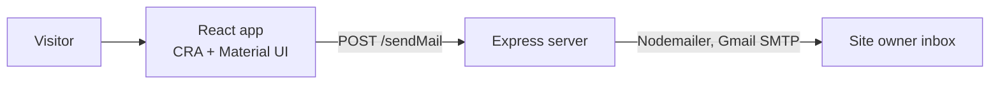

# Portfolio

My first personal portfolio site, built in early 2025: a React front end with a small Express back end that delivers contact-form messages by email.

> My current portfolio lives at https://mycreportfolio.com/samiksha. This repository is the earlier version.

## Tech stack

- **Front end:** React (Create React App), Material UI
- **Back end:** Node.js, Express, Nodemailer

## Structure

```
portfolio/   React app
backend/     Express server (Server.js, routes/contactRoutes.js)
```

## Run locally

```bash
# back end (listens on port 9000 in the front end config)
cd backend
npm install
npm start

# front end
cd portfolio
npm install
npm start
```

The contact form posts to `POST /sendMail`. Create a `.env` in `backend/` with your own mail credentials (see `contactRoutes.js` for the variable names). Never commit it.

The front end reads the API address from `portfolio/src/config/Url.js` (currently `http://localhost:9000`).

## High-level design (HLD)



A static React front end shows the portfolio sections. The only dynamic feature is the contact form, which calls a small Express service that relays the message by email.

## Low-level design (LLD)

| Piece | Detail |
| --- | --- |
| `backend/Server.js` | Express app entry point |
| `backend/routes/contactRoutes.js` | `POST /sendMail`: builds an HTML email from `name` and `email` in the request body and sends it with Nodemailer to the address in `EMAIL_USER` |
| `portfolio/src/config/Url.js` | `MAIN_URL`, the back end base address (`http://localhost:9000`) |
| Credentials | Read from environment variables via `dotenv`; never committed |

## Notes

This is a learning project and is not actively maintained.
